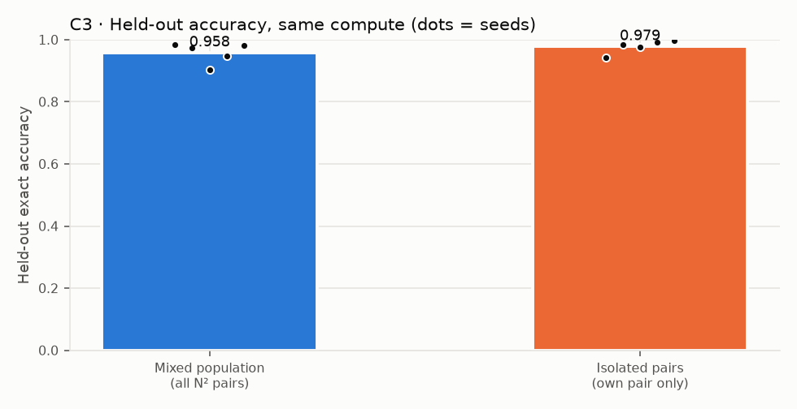
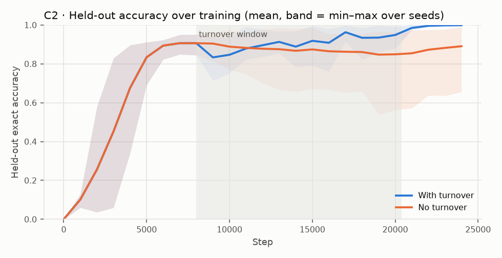
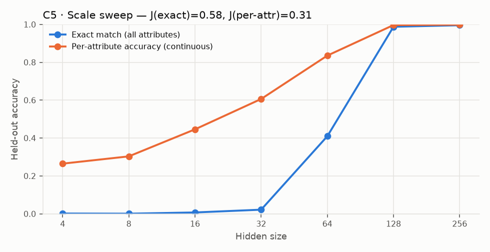
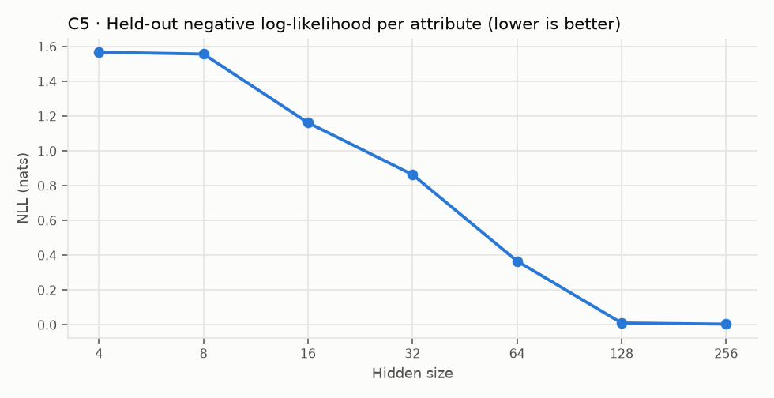

# EI-Bench v0 — results

Runs: **46** · total train time 136.2 min · device: `NVIDIA GeForce RTX 5090` · torch 2.15.0+cu132

## EI profile

| Criterion | Verdict | Key number |
|---|---|---|
| C1 Beyond the objective | **PASS** | held-out acc 0.993 [0.981, 1.000], ratio 0.99 |
| C2 Ongoing emergence | **PASS** | Δ(turnover) − Δ(none) = 0.108 [0.032, 0.210] |
| C3 Interaction as source | **FAIL** | mixed − isolated = -0.020 [-0.053, 0.010] |
| C4 Self-organized structure | **INCONCLUSIVE** | topsim gain 0.114 [0.061, 0.177] |
| C5 Jumps survive smooth metrics | **INCONCLUSIVE** | J(exact) 0.58, J(per-attr) 0.31 |

Values: mean [95% bootstrap CI over seeds]. Thresholds are pre-registered in DEFINITION.md.

## C1 · Beyond the objective

- Train accuracy: 0.998 [0.997, 1.000]
- Held-out accuracy (combinations never trained on): 0.993 [0.981, 1.000]  (chance = 2.44e-04)
- Held-out / train ratio: 0.99

## C4 · Self-organized structure

| Metric | Untrained | Trained | Gain |
|---|---|---|---|
| topsim | 0.112 [0.093, 0.127] | 0.226 [0.183, 0.271] | 0.114 [0.061, 0.177] |
| posdis | 0.020 [0.011, 0.033] | 0.090 [0.047, 0.132] | 0.070 [0.033, 0.105] |
| bosdis | 0.061 [0.049, 0.071] | 0.063 [0.049, 0.077] | 0.003 [-0.012, 0.015] |

## C3 · Interaction as source

- Mixed (all N² pairs): 0.958 [0.929, 0.982]
- Isolated (own pair): 0.979 [0.959, 0.993]
- Cross-play accuracy: mixed 0.958 [0.929, 0.982], isolated 0.000 [0.000, 0.000]
- Structure differences (mixed − isolated): topsim 0.005 [-0.028, 0.037], posdis -0.032 [-0.043, -0.019], bosdis -0.010 [-0.029, 0.010]

## C2 · Ongoing emergence

- Gain after turnover starts, with turnover: 0.092 [0.054, 0.131]
- Gain over the same steps, no turnover: -0.016 [-0.109, 0.039]
- Final held-out accuracy: turnover 0.999 [0.998, 1.000], none 0.891 [0.769, 0.975]
- Topsim gain difference: 0.029 [-0.019, 0.066]

## C5 · Jumps under smooth metrics

| Hidden | Seeds | Exact | Per-attribute | NLL |
|---|---|---|---|---|
| 4 | 3 | 0.002 | 0.265 | 1.568 |
| 8 | 3 | 0.001 | 0.303 | 1.558 |
| 16 | 3 | 0.007 | 0.446 | 1.163 |
| 32 | 3 | 0.022 | 0.607 | 0.864 |
| 64 | 3 | 0.410 | 0.836 | 0.367 |
| 128 | 3 | 0.988 | 0.997 | 0.011 |
| 256 | 3 | 0.996 | 0.999 | 0.004 |

J(exact) = 0.58, J(per-attribute) = 0.31, J(−NLL) = 0.32. J depends on the sweep grid (here: doubling hidden size).
