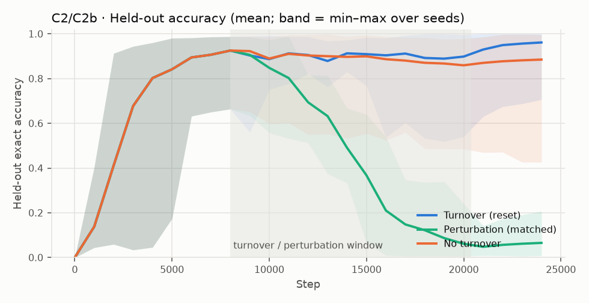
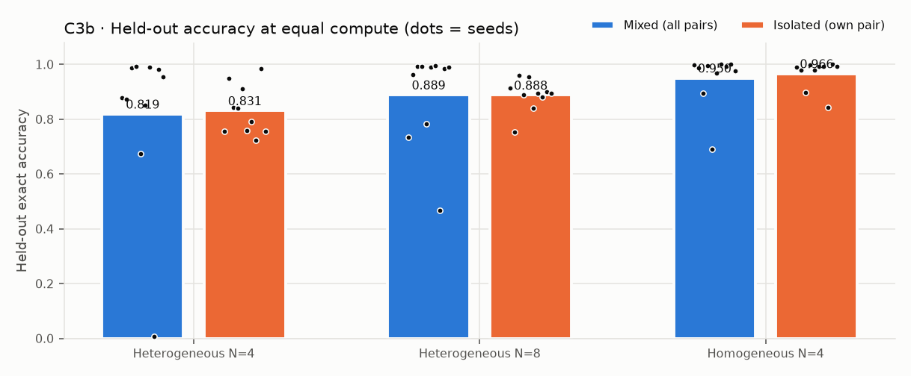
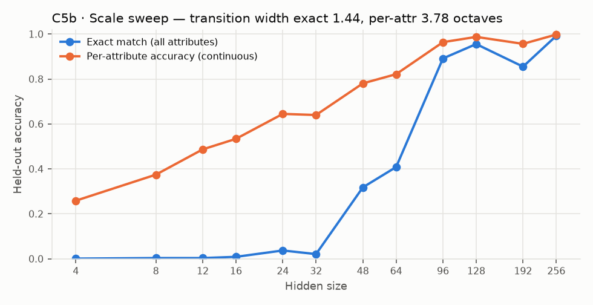
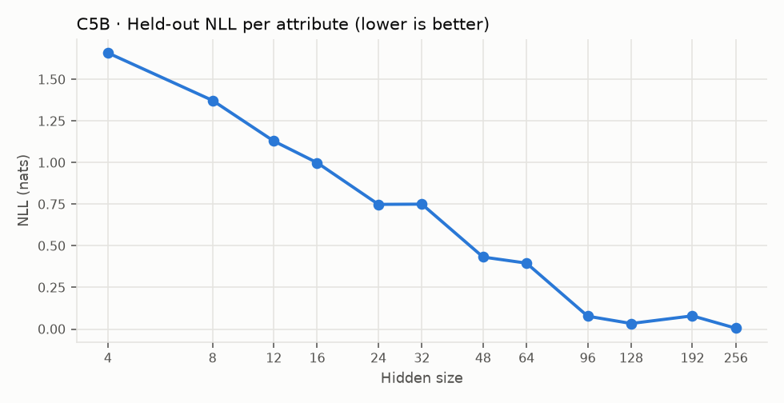

# EI-Bench v0.2 — results

Runs: **160** · summed train time 933.8 min · device: `NVIDIA GeForce RTX 5090` · torch 2.15.0+cu132

## EI profile

| Criterion | Verdict | Key number |
|---|---|---|
| C1 Beyond the objective | **PASS** | held-out acc 0.970 [0.941, 0.993], ratio 0.99 |
| C2 Ongoing emergence | **PASS** | Δ(turnover) − Δ(no_turnover) = 0.076 [0.033, 0.133]; MW p=0.00101 |
| C2b Ongoing emergence: reset vs. perturbation | **PASS** | Δ(turnover) − Δ(perturb) = 0.896 [0.813, 0.963]; MW p=0.000183 |
| C3b Interaction: heterogeneous population | **FAIL** | mixed − isolated = -0.012 [-0.221, 0.135]; MW p=0.162 |
| C4 Self-organized structure | **INCONCLUSIVE** | topsim gain 0.152 [0.131, 0.171]; posdis gain 0.076 [0.040, 0.112] |
| C5b Jumps: transition width | **MIRAGE** | R = w_c/w_e = 2.63 [1.99, 3.80] |

Values: mean [95% bootstrap CI over seeds]; MW = two-sided Mann–Whitney U (secondary). Thresholds are pre-registered in DEFINITION.md.

## C1 · Beyond the objective

- Train accuracy: 0.982 [0.962, 0.997]
- Held-out accuracy (combinations never trained on): 0.970 [0.941, 0.993]  (chance = 2.44e-04)
- Held-out / train ratio: 0.99
- Per seed: 0.998, 0.956, 1.000, 0.963, 0.861, 0.998, 0.995, 0.998, 0.998, 0.929

## C4 · Self-organized structure

| Metric | Untrained | Trained | Gain |
|---|---|---|---|
| topsim | 0.101 [0.080, 0.117] | 0.252 [0.226, 0.275] | 0.152 [0.131, 0.171] |
| posdis | 0.039 [0.023, 0.059] | 0.115 [0.086, 0.142] | 0.076 [0.040, 0.112] |
| bosdis | 0.058 [0.049, 0.069] | 0.076 [0.062, 0.089] | 0.017 [-0.001, 0.036] |

## C2 · Ongoing emergence

- Gain after turnover start — turnover: 0.036 [0.018, 0.058]; no_turnover: -0.040 [-0.091, -0.002]
- Final held-out accuracy — turnover: 0.962 [0.904, 0.993]; no_turnover: 0.885 [0.769, 0.968] (MW p=0.0538)
- Topsim gain difference: 0.045 [0.022, 0.070]
- Per-seed final (turnover): 0.996, 0.986, 0.979, 0.986, 0.707, 0.992, 1.000, 1.000, 0.985, 0.987
- Per-seed final (no_turnover): 0.985, 0.971, 0.764, 0.976, 0.426, 0.872, 0.993, 0.941, 0.996, 0.927

## C2b · Ongoing emergence: reset vs. perturbation

- Gain after turnover start — turnover: 0.036 [0.018, 0.058]; perturb: -0.860 [-0.923, -0.780]
- Final held-out accuracy — turnover: 0.962 [0.904, 0.993]; perturb: 0.066 [0.034, 0.104] (MW p=0.000182)
- Topsim gain difference: 0.149 [0.123, 0.181]
- Per-seed final (turnover): 0.996, 0.986, 0.979, 0.986, 0.707, 0.992, 1.000, 1.000, 0.985, 0.987
- Per-seed final (perturb): 0.062, 0.014, 0.049, 0.116, 0.102, 0.048, 0.041, 0.207, 0.008, 0.009

## C3b · Heterogeneous N=4 (scored)

- Mixed (all N² pairs): 0.819 [0.621, 0.951]; isolated (own pair): 0.831 [0.780, 0.888]
- Difference: -0.012 [-0.221, 0.135]; MW p=0.162
- Cross-play: mixed 0.819 [0.622, 0.951], isolated 0.000 [0.000, 0.000]
- Structure (mixed − isolated): topsim -0.017 [-0.055, 0.022], posdis -0.016 [-0.051, 0.027], bosdis -0.002 [-0.016, 0.011]

## C3b · Heterogeneous N=8 (secondary)

- Mixed (all N² pairs): 0.889 [0.779, 0.981]; isolated (own pair): 0.888 [0.851, 0.919]
- Difference: 0.001 [-0.117, 0.096]; MW p=0.121
- Cross-play: mixed 0.889 [0.779, 0.981], isolated 0.000 [0.000, 0.000]
- Structure (mixed − isolated): topsim -0.033 [-0.064, -0.001], posdis -0.052 [-0.076, -0.026], bosdis -0.018 [-0.027, -0.006]

## C3b · Homogeneous N=4 replicate (secondary)

- Mixed (all N² pairs): 0.950 [0.887, 0.993]; isolated (own pair): 0.966 [0.933, 0.992]
- Difference: -0.016 [-0.087, 0.041]; MW p=0.94
- Cross-play: mixed 0.950 [0.887, 0.993], isolated 0.000 [0.000, 0.000]
- Structure (mixed − isolated): topsim 0.002 [-0.036, 0.050], posdis -0.020 [-0.047, 0.014], bosdis -0.011 [-0.027, 0.006]

## C5b · Jumps: transition width

| Hidden | Seeds | Exact | Per-attribute | NLL |
|---|---|---|---|---|
| 4 | 5 | 0.001 | 0.259 | 1.660 |
| 8 | 5 | 0.003 | 0.375 | 1.374 |
| 12 | 5 | 0.003 | 0.487 | 1.130 |
| 16 | 5 | 0.009 | 0.534 | 0.999 |
| 24 | 5 | 0.037 | 0.645 | 0.749 |
| 32 | 5 | 0.021 | 0.640 | 0.751 |
| 48 | 5 | 0.318 | 0.781 | 0.433 |
| 64 | 5 | 0.408 | 0.822 | 0.396 |
| 96 | 5 | 0.892 | 0.964 | 0.077 |
| 128 | 5 | 0.956 | 0.988 | 0.034 |
| 192 | 5 | 0.855 | 0.957 | 0.079 |
| 256 | 5 | 0.992 | 0.998 | 0.005 |

Transition width (10–90%, octaves): exact 1.44 [0.98, 1.79], per-attribute 3.78 [3.22, 4.12]; R = 2.63 [1.99, 3.80]. (Unscored v0 statistic: J(exact) 0.49, J(per-attr) 0.19.)
