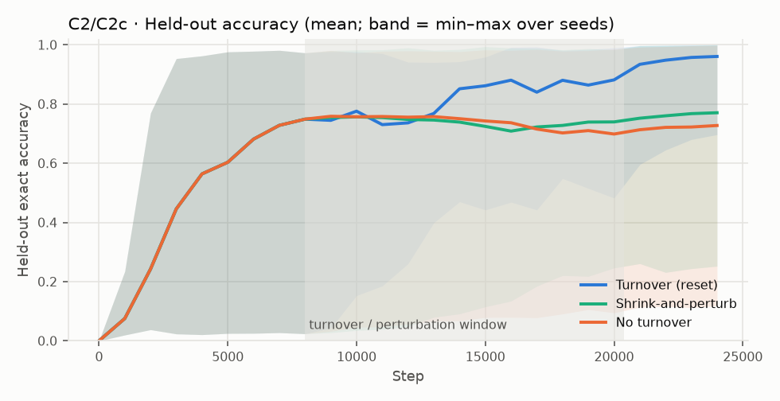

# EI-Bench v0.3 — results

Runs: **50** · summed train time 531.4 min · device: `NVIDIA GeForce RTX 5090` · torch 2.15.0+cu132

## EI profile

| Criterion | Verdict | Key number |
|---|---|---|
| C1 Beyond the objective | **PASS** | held-out acc 0.899 [0.800, 0.975], ratio 0.95 |
| C2 Ongoing emergence | **PASS** | Δ(turnover) − Δ(no_turnover) = 0.233 [0.069, 0.443]; MW p=0.0173 |
| C2c Ongoing emergence: reset vs. shrink-and-perturb | **PASS** | Δ(turnover) − Δ(shrink_perturb) = 0.190 [0.004, 0.409]; MW p=0.0452; reading: relearning from others adds beyond restored plasticity |
| C4 Self-organized structure | **FAIL** | topsim gain 0.121 [0.100, 0.142]; posdis gain 0.039 [0.021, 0.058] |

Values: mean [95% bootstrap CI over seeds]; MW = two-sided Mann–Whitney U (secondary). Thresholds are pre-registered in DEFINITION.md.

## C1 · Beyond the objective

- Train accuracy: 0.932 [0.860, 0.987]
- Held-out accuracy (combinations never trained on): 0.899 [0.800, 0.975]  (chance = 2.44e-04)
- Held-out / train ratio: 0.95
- Per seed: 0.985, 0.954, 0.995, 0.998, 0.754, 0.993, 0.990, 0.983, 0.985, 0.998, 0.195, 0.902, 0.995, 1.000, 0.978, 0.998, 0.963, 0.868, 1.000, 0.444

## C4 · Self-organized structure

| Metric | Untrained | Trained | Gain |
|---|---|---|---|
| topsim | 0.098 [0.086, 0.108] | 0.219 [0.199, 0.240] | 0.121 [0.100, 0.142] |
| posdis | 0.041 [0.031, 0.052] | 0.080 [0.063, 0.097] | 0.039 [0.021, 0.058] |
| bosdis | 0.066 [0.057, 0.076] | 0.071 [0.058, 0.086] | 0.005 [-0.010, 0.022] |

## C2 · Ongoing emergence

- Gain after turnover start — turnover: 0.212 [0.067, 0.411]; no_turnover: -0.021 [-0.092, 0.042]
- Final held-out accuracy — turnover: 0.961 [0.898, 0.997]; no_turnover: 0.728 [0.531, 0.890] (MW p=0.00728)
- Topsim gain difference: 0.062 [0.022, 0.108]
- Per-seed final (turnover): 0.981, 0.697, 0.998, 0.948, 0.997, 0.991, 0.999, 1.000, 0.996, 1.000
- Per-seed final (no_turnover): 0.970, 0.275, 0.623, 0.934, 0.941, 0.728, 0.782, 0.907, 0.118, 0.998

## C2c · Ongoing emergence: reset vs. shrink-and-perturb

- Gain after turnover start — turnover: 0.212 [0.067, 0.411]; shrink_perturb: 0.022 [-0.065, 0.127]
- Final held-out accuracy — turnover: 0.961 [0.898, 0.997]; shrink_perturb: 0.771 [0.611, 0.906] (MW p=0.0191)
- Topsim gain difference: 0.046 [0.004, 0.093]
- Pre-registered reading: **relearning from others adds beyond restored plasticity**
- Shrink-and-perturb diagnostics (240 events): new/old weight norm 0.44, cosine to old weights 0.945
- Per-seed final (turnover): 0.981, 0.697, 0.998, 0.948, 0.997, 0.991, 0.999, 1.000, 0.996, 1.000
- Per-seed final (shrink_perturb): 0.947, 0.252, 0.698, 0.975, 0.962, 0.893, 0.825, 0.727, 0.428, 1.000

## C2c_sp_vs_none · Shrink-and-perturb vs. no turnover (secondary)

- Gain after turnover start — shrink_perturb: 0.022 [-0.065, 0.127]; no_turnover: -0.021 [-0.092, 0.042]
- Final held-out accuracy — shrink_perturb: 0.771 [0.611, 0.906]; no_turnover: 0.728 [0.531, 0.890] (MW p=0.791)
- Topsim gain difference: 0.016 [-0.006, 0.037]
- Per-seed final (shrink_perturb): 0.947, 0.252, 0.698, 0.975, 0.962, 0.893, 0.825, 0.727, 0.428, 1.000
- Per-seed final (no_turnover): 0.970, 0.275, 0.623, 0.934, 0.941, 0.728, 0.782, 0.907, 0.118, 0.998
